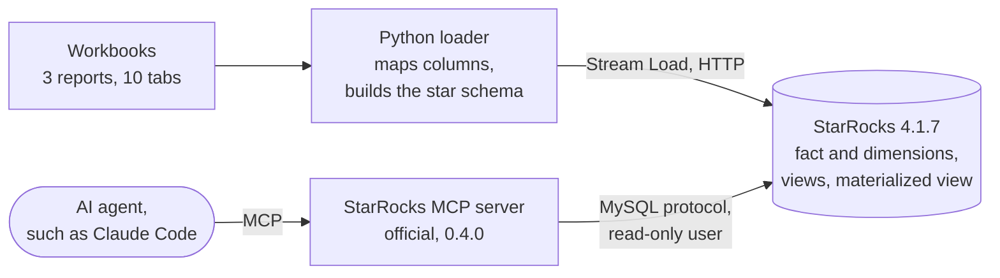

# StarRocks MCP Server PoC

[](https://github.com/jcsmei/starrocks-mcp-server-poc/actions/workflows/poc.yml)

A proof of concept that loads multi-tab marketing workbooks into
StarRocks as a small star schema, and gives an AI agent read-only
access to it through StarRocks's official MCP server.

Every push runs the whole PoC against a real StarRocks in GitHub
Actions: schema, load, data quality checks, query plans, the core
business questions, and the MCP server used as an agent would use it.
The results appear on each run's summary page.

**Read the [PoC report](docs/poc_report.md)** for the objective,
success criteria, design decisions, results, issues met and
recommendations for production.

## What it shows

| Area | How |
|---|---|
| Data modelling | A star schema: `fact_creative` with `dim_platform` and `dim_account` |
| Table design | A Duplicate Key fact table, partitioned by report date, hash-bucketed, with a sort key matching the common filters |
| Loading | Stream Load, StarRocks's HTTP batch load, with content-based labels so a retried load is never duplicated |
| Data quality | Row counts per report and date against the source files, allowed status values, no orphaned rows |
| Query optimisation | Query plans with and without a date filter (partition pruning), and before and after an asynchronous materialized view (automatic query rewrite) |
| Governance for agents | A read-only database user. The MCP server always offers a `write_query` tool, so the database itself refuses changes; the PoC checks that it does. |
| Correctness | Six core business questions answered as the agent user, each checked against an answer fixed in advance |

## Architecture



## Repository

| Path | What it holds |
|---|---|
| `data/` | Three synthetic workbooks: Paid Social (7 tabs), Site Direct (2) and Site Serve (1), about 700 rows |
| `sql/` | The schema, views, materialized view and the agent's read-only user |
| `poc/load.py` | Reads the workbooks, maps each report's columns to the star schema, and loads it |
| `poc/checks.py` | Data quality, the core questions and their agreed answers, and query plans |
| `poc/mcp_check.py` | Starts the official MCP server as the read-only user, uses its tools, and checks a write is refused |
| `poc/run_poc.py` | Runs every step and writes `results/summary.md` |
| `.github/workflows/poc.yml` | Runs the PoC on every push, against StarRocks in a service container |
| `docs/poc_report.md` | The PoC report |

## Running it yourself

You need Docker, with about 4 GB of memory free, and Python 3.12.

```bash
docker run -d --name starrocks -p 9030:9030 -p 8030:8030 -p 8040:8040 \
    starrocks/allin1-ubuntu:4.1.7
python -m pip install -r requirements.txt
AGENT_PASSWORD=choose-a-password python poc/run_poc.py
```

To query the data from Claude Code through the MCP server, add the
server to `.mcp.json` with the read-only user. The fastmcp pin is
needed: the server's 0.4.0 release fails to start with fastmcp 3.2 or
later.

```json
{
  "mcpServers": {
    "starrocks": {
      "command": "uv",
      "args": ["run", "--with", "mcp-server-starrocks==0.4.0",
               "--with", "fastmcp==3.1.1", "mcp-server-starrocks"],
      "env": {
        "STARROCKS_URL": "agent_reader:choose-a-password@127.0.0.1:9030/poc"
      }
    }
  }
}
```

## Author

Designed and built by Jack Mei, with Claude Code as his AI coding
assistant. Released under the MIT License.
