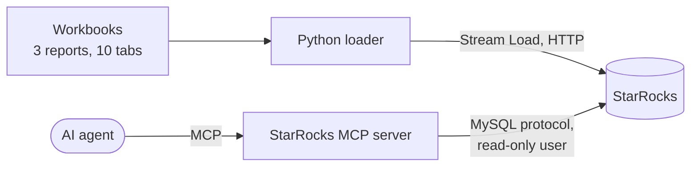

# StarRocks MCP Server PoC: report

| | |
|---|---|
| **Date** | 4 November 2026 |
| **Author** | Jack Mei, with Claude Code as his AI coding assistant |
| **StarRocks** | 4.1.7, single node, shared-nothing (the official all-in-one container) |
| **MCP server** | StarRocks's official `mcp-server-starrocks` 0.4.0 |
| **Outcome** | All success criteria met; every check passes on every push |

## 1. Objective

Show that an AI agent can answer business questions about marketing
data held in StarRocks, through StarRocks's official MCP server, with
answers that are exact and access that is governed by the database,
not by the agent's instructions.

## 2. Scope

**In scope:** three synthetic report workbooks (Paid Social with 7
tabs, Site Direct with 2, Site Serve with 1; 695 rows); a star schema;
batch loading; data quality checks; query optimisation; a read-only
agent user; the official MCP server.

**Out of scope:** volume and performance testing (695 rows prove
behaviour, not speed); streaming ingestion; a language model in the
automated run. The MCP tools are called exactly as an agent calls
them; the README shows how to connect Claude Code itself.

## 3. Success criteria and results

| # | Criterion | Result |
|---|---|---|
| 1 | Every workbook row is loaded once, and only once, even if a load is retried | Met: 695 of 695 rows; content-based Stream Load labels refuse a repeated load |
| 2 | Row counts per report and date match the source files | Met: 405, 190 and 100 |
| 3 | A question about one date reads only that date's data | Met: `partitions=1/2` instead of `2/2` |
| 4 | The most common aggregate is served from precomputed results without the query naming them | Met: the planner rewrote the query to `mv_status_counts` |
| 5 | Six core business questions return the answers agreed in advance | Met: 6 of 6 |
| 6 | An agent can explore and query the data through the official MCP server | Met: `table_overview` and `read_query` |
| 7 | The agent cannot change the data, even though the server offers a write tool | Met: `DROP TABLE` refused with "Access denied" |

## 4. Architecture

## 5. Design decisions

| Decision | Choice | Why |
|---|---|---|
| Data model | A star schema: `fact_creative`, `dim_platform`, `dim_account` | The three reports name the same ideas differently; one fact table with shared dimensions gives one way to ask every question. StarRocks's join performance makes a star schema practical without flattening. |
| Fact table type | Duplicate Key | Report snapshots are appended, never updated in place; every row is kept as loaded |
| Sort key | `report_date, platform_id, status` | Matches the filters in almost every question, so scans skip data using the sort order and zone maps |
| Partitioning | By report date (expression partitioning) | A question about one date reads one partition; old dates can be dropped as a unit |
| Bucketing | Hash on `creative_key`, 3 buckets | Spreads rows evenly; a creative's rows stay together |
| Platform identity | `(report, tab)`, not the tab alone | Two reports both have a "Default Buy" tab |
| Creative identity | Platform plus creative key | `CR-LIN-1000` exists on both the LinkedIn and LINE tabs, Live on one and Not Live on the other |
| Lineage | `source_file` and `source_tab` on every fact row | Any answer can be traced to its file and tab |
| Loading | Stream Load, with a label made from the content | The label makes a retried load idempotent: StarRocks refuses a label it has already committed |
| Precomputation | An asynchronous materialized view of status counts | The planner uses it automatically through query rewrite |
| Agent access | A user with `SELECT` only, on the PoC database | The MCP server always exposes `write_query`; only the database can guarantee it is refused |

## 6. Results in detail

**Query plans** for the status-count query, from `EXPLAIN`:

| Case | Table read | Partitions |
|---|---|---|
| No date filter | `fact_creative` | 2 of 2 |
| One date | `fact_creative` | 1 of 2 |
| One date, after the materialized view | `mv_status_counts` (`MaterializedView: true`) | 1 of 1 |

**Core questions**, asked as the read-only user:

| Question | Answer |
|---|---|
| Live creatives on Reddit, and campaigns | 29 creatives across 13 campaigns |
| Not live on Twitter Paid | 24 not live, and 8 with status Unknown, reported separately |
| Live on LinkedIn | 36 |
| Live on Display, Site Direct | 67 |
| Site Serve | 38 live, 62 not live |
| Is `CR-LIN-1000` live? | Live on LINE; Not Live on LinkedIn |

The business definitions behind these answers were agreed first: the
creative is the unit counted; "not live" means status `Not Live` only;
Unknown is always shown separately; a question about campaigns gets
both numbers.

**The MCP server, as the read-only user:** it listed seven tools
(`analyze_query`, `collect_query_dump_and_profile`, `db_summary`,
`query_and_plotly_chart`, `read_query`, `table_overview`,
`write_query`), described `fact_creative`, and answered 29 for Reddit
in 0.09 seconds. Its attempt to drop the table was refused: "Access
denied; you need (at least one of) the DROP privilege(s) on TABLE
fact_creative".

## 7. Issues met, and how they were resolved

| Issue | Cause | Resolution |
|---|---|---|
| The MCP server failed to start | Its 0.4.0 release imports `fastmcp.tools.tool`, which fastmcp 3.2 removed, and it sets no upper bound on fastmcp, so a fresh install pulls fastmcp 4 | Pinned fastmcp 3.1.1, the newest version with that module. The fix is on the server's main branch but not yet released; remove the pin when it is. |
| Validation warnings when the MCP session starts | The MCP client (SDK 2.3.0) first tries a newer discovery request that the server's library does not know | Harmless: the session falls back to the standard handshake. Expected to disappear as the server's dependencies are updated. |
| Two reports have a tab called "Default Buy" | Tab names are only unique within a workbook | The platform dimension is keyed on report and tab together |
| One creative ID on two platforms | `CR-LIN-1000` abbreviates both LinkedIn and LINE | Creative identity includes the platform, and a core question checks it |
| Site Direct has no creative ID column | The report identifies creatives by name | The loader's column mapping uses the name as the key for that report |

## 8. Recommendations for production

1. **Shared-data deployment** on object storage, with compute nodes,
   so storage and compute scale separately.
2. **Streaming ingestion** with Routine Load from Kafka, if reports
   arrive continuously, instead of batch files.
3. **A Primary Key table** if creative status changes in place and the
   current state matters more than snapshots.
4. **Refresh the materialized view on a schedule** (`REFRESH ASYNC
   EVERY`), or when the base table changes.
5. **Limit the agent user's resources:** a resource group and a query
   timeout, so a costly generated query cannot affect other users.
6. **Secure the MCP connection:** verified TLS (`STARROCKS_SSL_*`),
   and passwords from a secrets store, not configuration files.
7. **Partition lifecycle:** dynamic partitions with a retention
   period, so old report dates expire automatically.
8. **Monitoring:** the audit log for who queried what, and the MCP
   server's `analyze_query` for slow queries.
9. **BI tools** such as Tableau or Looker connect over the same MySQL
   protocol, and benefit from the same materialized views.

## 9. How to reproduce

Every push runs the PoC in GitHub Actions against StarRocks 4.1.7 in
a service container; the results are on each run's summary page. To
run it locally, see the README.
